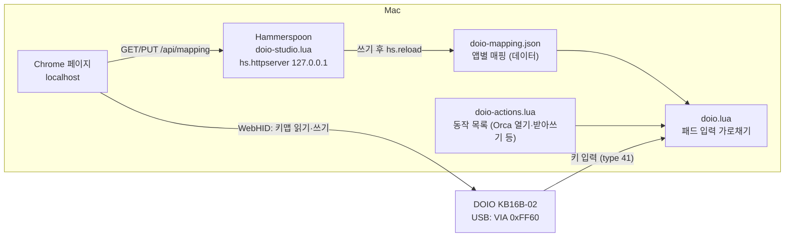

# DOIO 전용 설정 페이지 계획

결론: Hammerspoon 이 localhost 에서 페이지를 띄운다. 페이지 한 곳에서 패드 펌웨어 키맵과 Hammerspoon 앱별 매핑을 함께 고친다.

## 목표

- README 의 한계 셋을 펌웨어에서 푼다
  - 노브의 미디어 키(곡 넘김·볼륨)는 keyboard type 이 0 이라 노트북 키와 구분이 안 된다
  - 왼쪽 아래 `MO` 키는 레이어 키라 맥으로 이벤트를 보내지 않는다
  - 지금 레이어를 맥이 모른다
- `doio-*.lua` 를 고치지 않고 화면에서 앱별 매핑을 고친다

## 확인한 사실 (2026-11-20, 읽기 명령만 보냄)

| 항목 | 값 | 근거 |
|------|----|------|
| USB 연결 시 장치 | VID `0xFEED` / PID `0x6060`, 이름 `keyboard`, 제조사 `qmkbuilder` | `hidutil list`, `ioreg` |
| Bluetooth 연결 시 장치 | VID `0x1915` / PID `0xEEEE`, 이름 `DOIO_KB16B` | `hidutil list` |
| VIA(펌웨어 키맵을 USB 로 읽고 쓰는 프로토콜) 통신 인터페이스 | USB 에만 있다(usage page `0xFF60`, usage `0x61`). Bluetooth 에는 없다 | `hidutil list`, hidapi enumerate |
| VIA 프로토콜 버전 | 9 (옛 QMK keycode 체계: `KC_TRNS=0x0001`, `MO(n)=0x510n`, `TO(n)=0x501n`) | 명령 `0x01` 응답 |
| 레이어 수 | 9 | 명령 `0x11` 응답 |
| 노브 동적 매핑(명령 `0x14`) | 지원 안 함(응답 `0xFF`) | 명령 `0x14` 응답 |
| 노브 회전·누름 | 키맵 행렬 안에 있다(`0xA8~0xAE` 미디어 keycode 가 행렬에서 읽힘). 키맵을 바꾸면 노브도 바뀐다 | 명령 `0x12` 덤프 |
| 레이어 키 | 레이어 0 에 `MO(3)`, 각 레이어에 `TO(다음 레이어)` | 명령 `0x12` 덤프 |
| 유선 keyboard type | `24672-65261-0 = 40`. 패드 판별값 41 이 아니다 | `defaults read /Library/Preferences/com.apple.keyboardtype` |

### 아직 모름

- 행렬 크기와 칸↔물리 키 대응. 덤프 주기로 보면 레이어당 35칸으로 추정한다. VIA 정의 JSON 으로 확정해야 한다
- USB 로 바꾼 키맵을 Bluetooth 연결에서도 쓰는지. 블루투스 모듈이 별도 키맵을 쓸 수 있다
- 유선 연결 중 지금 Hammerspoon 매핑이 동작하는지. 코드상으로는 type 40 이라 패드로 인식하지 않는다(실측 안 함)

## 구조

## 펌웨어 쪽 방향

맥이 구분 못 하는 입력만 일반 키로 바꾼다. 일반 키는 keyboard type 41 이 붙어 패드 입력으로 가려진다.

| 입력 | 지금 | 바꿀 값(초안) |
|------|------|---------------|
| 왼쪽 작은 노브 회전 | 곡 넘김 | `F13` / `F14` |
| 큰 노브 회전 | 볼륨 | `F15` / `F16` |
| 왼쪽 작은 노브 누름 | 재생 | `F17` |
| 큰 노브 누름 | 음소거 | `F18` |
| 오른쪽 작은 노브 누름 | 레이어 넘김 | 결정 필요 |
| 왼쪽 아래 `MO` | `MO(3)` | 결정 필요 |

## 단계

1. 유선 keyboard type 을 41 로 등록한다(사용자 실행, sudo):
   `sudo defaults write /Library/Preferences/com.apple.keyboardtype keyboardtype -dict-add "24672-65261-0" -int 41`
2. 키맵 전체(9 레이어)를 JSON 으로 백업한다. 롤백 경로다. 쓰기 전에 반드시 먼저 한다
3. VIA 정의 JSON 을 구해 행렬↔물리 키 대응을 확정한다
4. 리팩터링 커밋: `doio-*.lua` 매핑을 `doio-mapping.json` + `doio-actions.lua` 로 옮긴다. 동작은 바꾸지 않는다
5. 기능 커밋: `doio-studio.lua` (httpserver + `/api/mapping`) 와 매핑 편집 화면
6. 기능 커밋: 펌웨어 편집 화면(WebHID, 명령 `0x12` 읽기 / `0x05` 쓰기 / 백업·복원)
7. 기능 커밋: 노브를 F13~F18 로 바꾸고 `doio.lua` 의 노브 이름을 새 keycode 로 연결한다

## 검증

- 4번: 리팩터링 전후로 패드 배치 보기(`4` 키) 화면이 같은지 비교한다
- 6번: 쓰기 → 다시 읽기 → 백업과 diff. 복원 후 백업과 일치하는지 확인한다
- 7번: USB·Bluetooth 각각에서 노브 입력이 `hs.eventtap` 에 type 41 로 들어오는지 로그로 확인한다
